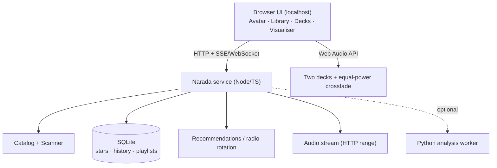

# ADR-001: Interface platform for Narada

- Date: 2026-10-30
- Status: Proposed (awaiting owner decision)
- Supersedes: none

## Context

Narada needs to behave like a local radio DJ: continuous rotation over a large
library, smooth transitions, a distinctive animated avatar, and a UI that people
can actually click.

Current implementation is a Node.js/TypeScript terminal application:

- Engine: scanner, native helper, SQLite catalog, metadata probe, analysis cache,
  recommendations, history, playlists.
- Playback: external VLC process driven over its RC interface.
- UI: hand-rolled ANSI renderer (`src/ui/*`), keyboard-only.

Measured limitations of the terminal path:

| Need | Terminal reality |
|---|---|
| Mouse interaction | Not implemented at all. Would require SGR mouse parsing, hit-testing, and per-widget regions. |
| Animated avatar | Text/ANSI art, or sixel/kitty graphics if the terminal supports it. GNOME Terminal support is unreliable; animation is out of reach. |
| Visual transitions / waveform | Character cells only; no real graphics, no video, no shaders. |
| Layout robustness | Panel breakpoints discard panels at 70–90 columns; different terminal sizes produce materially different products. |
| Rich typography, colour, motion | Severely constrained. |
| Web links, artwork, lyrics, gestures | Not practical. |

## Options

### Option 1 — Stay CLI, fix it

Effort: medium. Reuses 100% of current code.

Would require: mouse protocol support + hit-testing, deterministic startup category,
cwd-independent DB path, terminal-size layout rework, radio rotation, and accepting
a text-only avatar.

Verdict: fixes the bugs, but permanently caps the product at "nice TUI". The avatar
and transition visuals the owner wants cannot be delivered.

### Option 2 — Native Linux desktop app (GTK4/Qt, or Tauri shell)

Effort: high. Reuses engine + service layer, replaces UI.

Pros: real window, real graphics, media keys, native file dialogs, offline.
Cons: Linux-only, packaging/distribution work, GTK/Qt learning surface, and most of
the "crazy UI" work ends up in a webview anyway if Tauri is used.

### Option 3 — Local web app (localhost)

Effort: medium-high, but highest payoff per unit of work.

Architecture: existing Node/TS engine becomes a local HTTP service
(`127.0.0.1`, random port, token-gated). Browser UI renders the avatar, library,
queue and visualiser. Audio played with the Web Audio API from two decks.

Pros:

- Cross-platform by construction (Linux, Windows, macOS) — the owner explicitly
  wants this.
- Native mouse, hover, drag, keyboard, touch.
- Real animated avatar (Canvas/WebGL/Rive/Lottie), video transitions, shaders.
- Crossfade and loudness work natively: two `<audio>` elements + `GainNode`
  equal-power curves. No FFmpeg pre-render, no VLC, no RC polling, no silent-audio
  class of bug.
- Media Session API gives OS media keys and a now-playing card.
- Installable as a PWA; can later be wrapped by Tauri/Electron for a real app icon
  with zero UI rewrite.
- The whole existing domain layer is reused unchanged.

Cons / risks:

- Browser autoplay policy: requires one user gesture ("Start radio"). Solvable.
- Local file access must go through the service (HTTP range streaming). Straightforward.
- One more process to manage (service + browser tab). Mitigated by a launcher script
  that starts the service and opens the browser.
- If the service is exposed beyond loopback it becomes a security surface. Bind to
  `127.0.0.1` only, require a per-session token, no directory traversal.

## Decision

Adopt **Option 3, web-first**, with the CLI kept as a secondary "power/headless"
mode and a later Tauri packaging step:

The terminal UI is not thrown away: it remains as `narada --cli`, useful for
headless machines and debugging, but it is no longer the primary product surface.

## Consequences

Positive:

- Avatar, transitions, and mouse support become normal work instead of hacks.
- Playback engine is in-process; removes VLC RC fragility.
- Cross-platform reach with one UI codebase.
- CLI remains available, so no sunk cost is lost.

Negative:

- UI layer must be rebuilt (the engine, ~55–60% of the code, survives).
- New moving parts: service lifecycle, port/token handling, streaming.
- Needs a documented local-security model.

## Rejected alternatives

- Ripping YouTube or similar for assets: rejected, legal risk.
- Keeping VLC as the audio engine behind a web UI: rejected, keeps the silent-audio
  and process-orchestration failure modes for no benefit.
- Electron-first native app: rejected for now; Tauri/PWA covers it later without
  rewriting the UI.

## Follow-up decisions required

1. UI framework: React + Vite, Svelte, or vanilla + Canvas. (Recommendation: React +
   Vite; the owner's existing React familiarity and ecosystem for waveform/avatar
   libraries.)
2. Avatar medium: Rive (interactive state machine, small files) vs Canvas/WebGL
   custom. (Recommendation: Rive for the character, WebGL for audio-reactive effects.)
3. Where the "radio brain" lives: service-side scheduling (recommended) vs UI-side.
